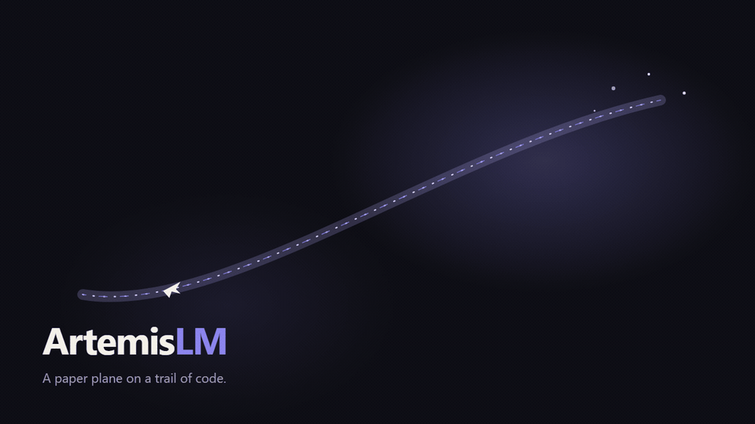
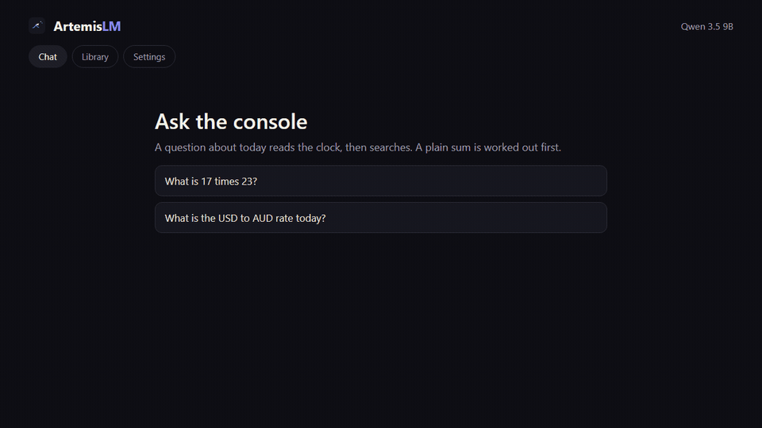
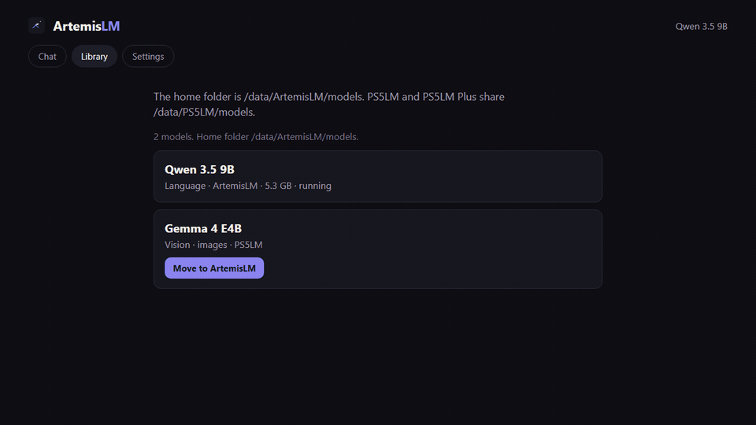

<p align="center">
  
</p>

<h1 align="center">ArtemisLM PS5</h1>

<p align="center">
  <b>A language model that lives on the console.</b><br>
  The PlayStation runs the model. A phone or a computer on the same network opens the chat, the library and the settings.
</p>

<p align="center">
  <b><a href="https://github.com/joelsmithlowe/ArtemisLM-PS5">Source</a></b> ·
  <a href="#try-it">Get started</a> ·
  <a href="CHANGELOG.md">Changelog</a>
</p>

ArtemisLM PS5 is its own title, PPSA98010, with its own folder, `/data/ArtemisLM`. Models live in
`/data/ArtemisLM/models`. The app also reads `/data/PS5LM/models`, the folder PS5LM and PS5LM Plus
already share, and the same kind of folder on an M.2 or USB drive. A copy found elsewhere can stay
where it is, or be moved home and the old file removed.

The chat reads the console clock, searches the web, and works out a plain sum before it asks the
model. A conversion, a date, a constant, an element, or a status code comes from a table kept in
the app. A research question also reads the text of one page. Settings on the television and on the
phone page cover context, flash attention, the prompt batch, and how much spare memory to keep.
The current setup is written in one line, and a choice that leaves the measured default is marked.
Measured is the spare this console was tested with. Agent mode names a coordinator and a worker.
The console keeps one model on the GPU. Plan writes a short plan and then the answer on the loaded
model. Hand off, from the page, restarts onto the worker after the plan. LM Studio does not take
the PlayStation as one of its own models. It calls the console as an agent at
`http://<PS5>:47282/mcp`. The steps are [below](#lm-studio). An OpenAI client still uses port 47281.

<p align="center">
  
</p>

<p align="center">
  
  
  <br><sub>Chat works out a sum before the model answers. Library can move a model from the PS5LM folder into /data/ArtemisLM/models.</sub>
</p>

## What it does

- **It runs on the GPU.** llama.cpp's Vulkan backend on the console's RDNA 2 GPU, with 11.4 GB of the
  shared memory for the model and its context. Every architecture and quantization llama.cpp knows
  comes along. Every layer stays on the GPU.
- **It answers your network.** OpenAI's `/v1/chat/completions`, Anthropic's `/v1/messages` (Claude Code
  works against it) and a chat page in any browser. Point a client at `http://<console>:47281` and use
  any model name: the loaded one answers. With nothing loaded, that address still opens the page, so a
  model can be downloaded or a folder added. The paths are unchanged. Port 47282 is the library: it
  lists models, loads and unloads, saves settings, and answers `POST /mcp`, `POST /v1/agent`, and
  `POST /reference`.
- **It decides, too.** Load a decision model and the console answers TypeSafe's `/v1/systemone`:
  choice, score and yes-or-no questions about text and images, the API Ollaya serves on a PC.
- **It shows its work.** Every request streams across the TV as a chat: which device asked, what it
  asked, and the reply as it is written. Square sends a demo and Triangle opens a keyboard, so the
  console can be tried from the couch.
- **It watches the console.** A Console page charts temperature, power, GPU and CPU load over the
  last two minutes or the last hour, beside the readings now. Home shows how fast the model is
  running, and how full its memory and context are.
- **It keeps a few tables.** Unit conversion, calendar dates, constants, elements, HTTP statuses,
  and short text codes stay in the app. The library port answers `POST /reference`. LM Studio can
  call the same table.
- **It picks what fits.** The planner reads each GGUF and gives it the longest context and best cache
  that fit the memory free. A Suggested list holds models measured on the console, and the app
  downloads from Hugging Face by itself, to internal storage, the M.2 drive or a USB drive.
- **It reads images.** Models with an image projector (Gemma 4, MiniCPM-V, d1) take pictures in chat
  and in decisions.

| Model | Size | On a PS5 Slim |
|---|---|---|
| Qwen 3.5 0.8B, Q4_K_M | 0.5 GB | 207 tokens a second |
| Qwen 3.5 9B, Q4_K_M | 5.3 GB | 55 tokens a second |
| Qwen 3.8 27B, UD-Q2_K_XL | 9.2 GB | about 20 tokens a second, 64k context |
| d1 Omni 600M, a decision model | 1.1 GB | 3 questions in 0.3 s; a 720p image and 7 questions in 2.9 s |

## Decision models

A decision model reads a state and answers typed questions in one forward pass, with no text
generated. The request is `/v1/systemone`, the API [Ollaya](https://github.com/ollaya-dev/ollaya)
serves on a PC.

```sh
curl http://<console>:47281/v1/systemone -H 'Content-Type: application/json' -d '{
  "state": "I was charged twice this month. Refund me or I cancel.",
  "questions": {
    "intent": {"type": "choice", "instructions": "What does the customer want?",
               "criteria": {"refund": null, "information": null, "cancel": null}},
    "angry":  {"type": "noul", "instructions": "Is the customer angry?"}
  }
}'
```

The Suggested list has d1 Omni 600M, d1 3B and Clef Flash. Any GGUF that carries llama.cpp's
decision metadata loads the same way, and the app labels it a decision model.

## Try it

You need a PS5 on firmware 7.00 to 13.60, jailbroken, with these payloads loaded:

| Payload | For | |
|---|---|---|
| [kstuff-lite](https://github.com/EchoStretch/kstuff-lite) | the kernel patches homebrew runs on | required |
| [etaHEN](https://github.com/etaHEN/etaHEN) | homebrew support | required |
| [ShadowMountPlus](https://github.com/drakmor/ShadowMountPlus) | puts the app on the home screen from `/data/homebrew` | required |
| [elfldr](https://github.com/ps5-payload-dev/elfldr) (port 9021) | temperature, power and real free space, through ps5-exporter | recommended |
| [ftpsrv](https://github.com/ps5-payload-dev/ftpsrv) (port 2121) | installing the app, copying models from a PC | recommended |

1. Download `artemislm-ps5-app-vX.Y.Z.zip` from the [releases](https://github.com/joelsmithlowe/ArtemisLM-PS5/releases) and unzip it.
2. Copy the `PPSA98010` folder to `/data/homebrew` over FTP. ShadowMountPlus adds **ArtemisLM PS5** to the
   home screen. PS5LM can stay installed beside it.
3. Open ArtemisLM PS5. The first launch creates `/data/ArtemisLM/models`. With nothing loaded, open
   `http://<console>:47281`. Library can download a model, and Settings can add a folder that already
   has one. A model can also come from **Models > Suggested**, or from a `.gguf` copied into that
   folder, or into `ArtemisLM/models` on a USB drive. A model already in
   `/data/PS5LM/models` (PS5LM or PS5LM Plus) is read too. **Settings > Library** can copy
   those files into `/data/ArtemisLM/models` and delete the old ones.
4. Load it. Once Home says Ready, the same address is the chat, or point your OpenAI or
   Anthropic client at it. Library and Settings on that page use port 47282 on the same console.
   A question about today uses the console clock, then the web search. A plain sum is worked out first.
   A conversion, a calendar date, a physical constant, an element, or an HTTP status comes from a
   small table kept in the app. That table is not downloaded and it is not stored under `/data`.
   With file tools on, the browser chat can save a project in `/data/ArtemisLM/projects`
   (a Node server, a static page, or a Python program), review the files, and leave them
   to copy off with FTP. The console does not start Node or Python. The same switch lists
   projects, scratch, models, and a USB or M.2 drive, and it keeps short notes. A note is
   added to a later chat only when the question matches it.

To update, open **Settings > Sound and storage > App update**, or the same button on the
phone page. The app checks the GitHub releases, checks the zip, and installs it into
`/data/homebrew/PPSA98010`, then restarts. The first copy of that folder still has to be
put there over FTP. Models and settings stay in `/data/ArtemisLM`. Copying a new folder
over the old one still works. Using it from coding tools (opencode, Codex, Claude Code) is in
[docs/CLI.md](docs/CLI.md).

| Where | Button | Does |
|---|---|---|
| Everywhere | L1 / R1 | Home, Models, API, Console, Settings |
| Home | Cross | change the model |
| Home | Square / Triangle | send a demo request / type a message |
| Models | D-pad, Cross | choose a section and a model; load, unload or download it |
| Models, Search | L2 / R2, Square | change the search; check whether a file fits |
| Models, Downloads | Cross, Square | pause or resume; cancel (press twice) or clear |
| Console | L2 / R2 | the last two minutes / the last hour |
| Settings | D-pad, Cross | choose a category and a row; flip it, or pick from its list |
| Settings, Diagnostics | Square, Triangle | app or server log; errors only |

## The screens

L1 and R1 move along the bottom: **Home**, **Models**, **API**, **Console**, **Settings**.

**Home** is the status page. With nothing loaded it says the page is open, shows the setup in one line, the network address, free memory, and free space on the first drive. Square sends a demo and Triangle opens the keyboard. With a model loaded it shows the context, the cache, and whether two chats are on. A strip along the bottom reads GPU, CPU, prompt speed, and any setup that is not the measured default. Green means Ready. Blue means a reply is being written. Red means the model stopped.

**Models** has four lists: on this PS5, Suggested, Search, and Downloads. Search steps through Popular, Qwen, Gemma, Llama, Mistral, Phi, and Granite. Square on a file checks whether it fits. A download that needs the memory asks before it unloads the model that is loaded.

**API** is the address page. With nothing loaded it prints the page, `http://<console>:47281`. With a model loaded it prints the API base, `http://<console>:47281/v1`. Under that, the LM Studio agent is `http://<console>:47282/mcp`. Opening `/v1` in a browser with nothing loaded is sent to the page. Six rows are the chat port:

| | | |
|---|---|---|
| POST | `/v1/chat/completions` | OpenAI chat, streaming and tools |
| POST | `/v1/messages` | Anthropic Messages, for Claude Code |
| POST | `/v1/completions` | Plain text completion |
| POST | `/v1/systemone` | Decision questions, when a decision model is loaded |
| GET | `/v1/models` | The loaded model. An empty list when nothing is loaded |
| GET | `/health` | Ready, or 503 while nothing is loaded |

A row is lit when it matches the model that is loaded. The panel on the right counts how many answers have been served and names the two library calls that do not fit on that list: `POST /v1/agent` and `POST /reference`, both on port 47282. An example curl is drawn under that. With nothing loaded, the same panel says the page is open and repeats the setup line.

**Console** charts temperature, power, GPU, and CPU for the last two minutes or the last hour. The header reads Cool, Warm from 70°C, or Hot from 85°C. Hot is a label on the screen. It is not a point where the app shuts down.

**Settings** has nine categories: Startup, Library, Context, Sampling, Chat, Agent, Sound and storage, Diagnostics, and Credits. A value that leaves the measured default is marked, and that category gets a mark on the left. Context, cache, flash attention, the prompt batch, chats at once, memory fit, and sampling apply at the next load. File tools, web search, the clock, how many search hits to keep, and how many messages the phone sends apply to the next question. Credits is the list of the work this build stands on. Diagnostics shows the app log or the server log.

The phone page, `http://<console>:47281`, has three tabs: Chat, Library, and Settings. Settings uses the same groups. An extra model folder can be typed there. It has to be an existing folder under `/data` or `/mnt`. Clearing the scratch folder is on the television only.

## LM Studio

LM Studio keeps its own model on the computer. The PlayStation is an agent it can call. On a current install the console speaks that protocol itself, so LM Studio does not need a program on the computer.

Open **Program** in the right-hand sidebar, then **Install**, then **Edit mcp.json**. LM Studio reads that file when you save it. Add the address from the API page. There is no token.

```json
{
  "mcpServers": {
    "artemis-ps5": {
      "url": "http://192.168.1.19:47282/mcp"
    }
  }
}
```

Use the console's address. The call is `POST /mcp` with one JSON-RPC message. `GET /mcp` only tells the client to post. The console answers in this order:

1. `initialize` returns the name ArtemisLM PS5, the app version, and that tools are available.
2. `notifications/initialized` is accepted and has no body.
3. `tools/list` returns five tools.
4. `tools/call` runs one tool and returns its text. A failed tool comes back with `isError`. An unknown name is rejected the same way. There is no shell tool.

| Tool | Does |
|---|---|
| `artemis_status` | Version, the loaded file, agent mode, the chat address, and the MCP address |
| `artemis_models` | Each installed model, whether it fits, its context, and its path |
| `artemis_ask` | One question to the loaded chat model. When Agent mode is Plan or Hand off, a short plan is written first on that same model. A long prompt can take minutes |
| `artemis_load` | Restarts the app onto a path from `artemis_models`. Wait, then call `artemis_status`, before the next ask. A model that does not fit is refused |
| `artemis_reference` | The tables kept in the app. `tool` is `convert`, `calendar`, `lookup`, `text`, or `note`. Nothing is downloaded and nothing is written under `/data` |

One model stays on the GPU. Hand off does not restart from this call. The answer stays on the loaded model, and the text says so. A decision model cannot take `artemis_ask`. Those questions stay on `POST /v1/systemone` at port 47281.

`POST /v1/agent` on port 47282 is the same ask without the tool wrapper. The body can carry `prompt`, `system`, `messages`, `max_tokens`, and `plan`. The reply is an OpenAI chat completion plus an `artemis` object with the plan.

A console that does not yet speak `/mcp` can still be reached by a small program LM Studio launches. `artemis_reference` through that program needs 0.12.0 or later on the console. The other four tools have been there since 0.10.0.

```json
{
  "mcpServers": {
    "artemis-ps5": {
      "command": "node",
      "args": ["D:/path/to/PS5LM-0.9.0/scripts/lmstudio/artemis-mcp.mjs"],
      "env": { "ARTEMIS_HOST": "192.168.1.19" }
    }
  }
}
```

The copy to edit is [scripts/lmstudio/mcp.example.json](scripts/lmstudio/mcp.example.json). Coding tools that want the console as their own model, rather than as an agent, are in [docs/CLI.md](docs/CLI.md).

## Want to tinker?

C++ on [ps5-homebrew-ui](https://github.com/blackbearreloaded/ps5-homebrew-ui), llama.cpp with
ggml-vulkan on [PS5_Vulkan](https://github.com/mihawk-99/PS5_Vulkan)'s RADV, built on Linux.

[Building](docs/BUILDING.md) · [Console notes](docs/CONSOLE.md) · [Porting](docs/PORTING.md) ·
[Research](docs/RESEARCH.md) · [Models that fit](docs/MODELS.md) · [Roadmap](docs/ROADMAP.md) ·
[Changelog](CHANGELOG.md) · [The original payload](docs/PAYLOAD.md)

## Thanks

- [abhi245y](https://github.com/abhi245y), who built the native GPU app this one grew from (PS5LM Plus).
- [llama.cpp and ggml](https://github.com/ggml-org/llama.cpp), which do the actual work.
- [Mihawk-99](https://github.com/mihawk-99) for PS5_Vulkan and RADV on the PS5, and
  [PS5CEMU-HAR](https://github.com/premohq/PS5CEMU-HAR) for the driver patches in `patches/mesa`.
- [BlackBearReloaded](https://github.com/blackbearreloaded) for ps5-homebrew-ui, ps5-opengl and
  ps5-homebrew-dev-protocol, and [John Törnblom](https://github.com/ps5-payload-dev) for the SDK.
- [Marice](https://github.com/Marice/ps5-exporter) for ps5-exporter, which the app carries.
- [Manrope](https://github.com/sharanda/manrope) (OFL) for the type, and
  [PocketVibe](https://github.com/cobanov/pocketvibe) for the interface sounds.

---

GPL-3.0-or-later, see [LICENSE](LICENSE). llama.cpp keeps its MIT licence, Manrope its OFL. No Sony
SDK files, keys, firmware or model weights are in this repository.

ArtemisLM PS5 is not affiliated with Sony Interactive Entertainment. "PlayStation" and "PS5" are trademarks
of Sony Interactive Entertainment. This build stands on PS5LM by cobanov; the credits on the console name that work.
