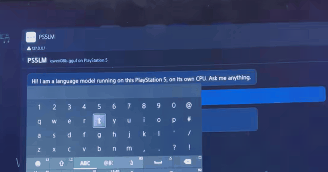

# The PS5LM payload (archived)

This is the README of the original PS5LM payload by [Mert Cobanov](https://github.com/cobanov),
kept as it was when this fork moved to the native app. The payload still works and is
maintained upstream at [cobanov/PS5LM](https://github.com/cobanov/PS5LM); this fork's
README covers the native app.

## The payload (upstream v0.1)

The original PS5LM is a payload that needs no install: one `ps5lm.elf` opens a model library in the PS5's browser, for small models (up to 1.6 GB, Qwen3.5 0.8B and 2B). See [docs/ROADMAP.md](ROADMAP.md) and [docs/CONSOLE.md](CONSOLE.md).

<p align="center">
  <a href="https://ps5lm.cobanov.dev"></a>
</p>

### Install the payload

You need a PS5 you own on firmware 7.00 to 13.60, jailbroken, with a payload loader (Payload Manager from WebKit Autoloader, or elfldr on port 9021).

**From Payload Manager**, which also brings updates:

1. *Settings*: turn on **Multiple Payload Sources**.
2. Add the source `https://ps5lm.cobanov.dev/payloads.json`.
3. Install **PS5LM** from the list and load it.

**Or by hand**: download `ps5lm.elf` from the [latest release](https://github.com/cobanov/PS5LM/releases/latest) and load it like any payload (upload it in Payload Manager, or send it to an ELF loader on port 9021).

Once it runs, the PS5's browser opens the PS5LM library. Press **Download** on a model, then **Run**, then **Open chat**. Type with the DualSense.

The library also works from a phone or computer on the same network at `http://<console IP>:8082`, and the chat at port 8081 speaks the OpenAI API. Models are stored in `/data/PS5LM/models`; a GGUF copied there over FTP shows up too.

Limits for now: a payload can only keep about 1.6 GB of model locked in memory without starving the home screen, so the catalog has Qwen3.5 0.8B (13 to 21 tok/s) and Qwen3.5 2B (about 9 tok/s). Bigger models need a native app ([#4](https://github.com/cobanov/PS5LM/issues/4)).

## Building from source

Needs the [ps5-payload-dev SDK](https://github.com/ps5-payload-dev/sdk) and a host LLVM.

```sh
# macOS
brew install llvm@21 lld socat cmake ninja
# Debian / Ubuntu
sudo apt install clang-18 lld-18 socat cmake ninja-build

git clone --recursive https://github.com/abhi245y/PS5LM
cd PS5LM
scripts/setup-sdk.sh
source scripts/env.sh

make -C probes/memprobe          # Phase 0 probe
scripts/build-llama.sh           # llama-cli, llama-server, llama-bench for the PS5
```

## Running on the console

You need a PS5 you own on firmware 7.00 to 13.60, jailbroken, with an ELF loader listening on port 9021 ([elfldr](https://github.com/ps5-payload-dev/elfldr)).

```sh
scripts/host-relapse.sh          # serves the Relapse exploit page; open it in the PS5's browser
export PS5_HOST=192.168.1.50     # your console
scripts/console-setup.sh         # FTP, kernel log and shell payloads
scripts/send.sh probes/memprobe/memprobe.elf
```

The probe streams its results back and also writes them to `/data/PS5LM/memprobe.txt` on the console.

With [ftpsrv](https://github.com/ps5-payload-dev/ftpsrv) running too (port 2121), `scripts/run.sh` uploads a llama.cpp tool and starts it with arguments:

```sh
# copy a model to /data/PS5LM/models first (FTP or USB)
scripts/run.sh llama-cli -m /data/PS5LM/models/model.gguf -p "Hello from a PS5" -n 64
scripts/run.sh llama-server -m /data/PS5LM/models/model.gguf --host 0.0.0.0 --port 8081
```
